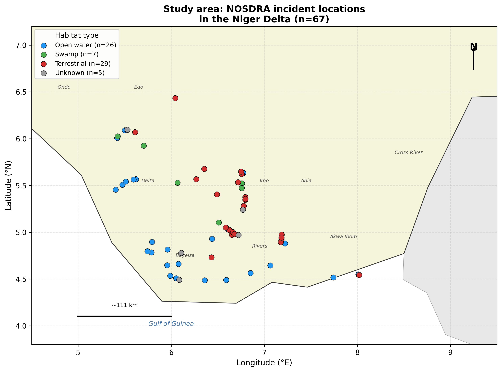
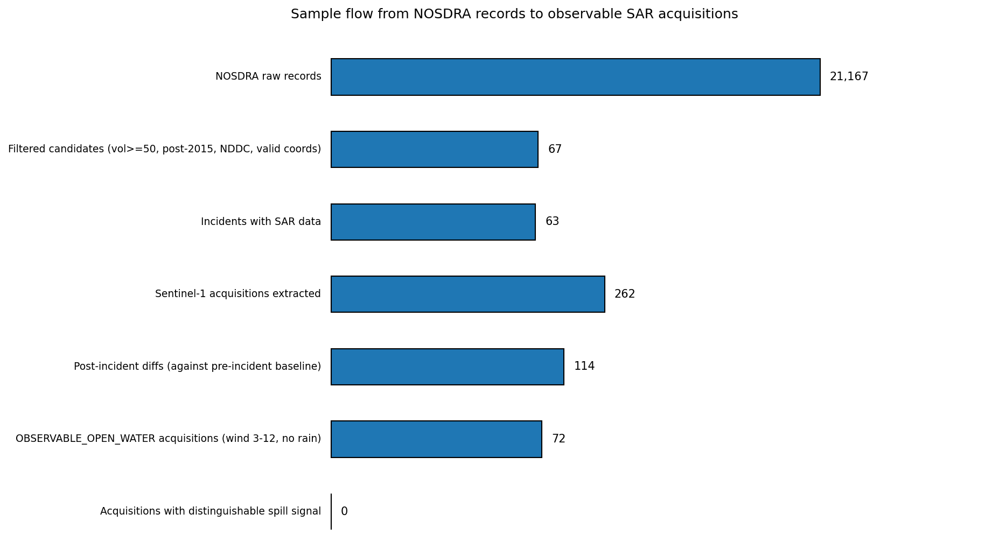
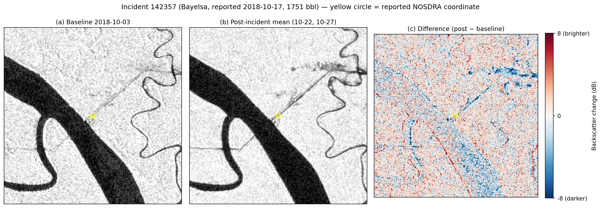
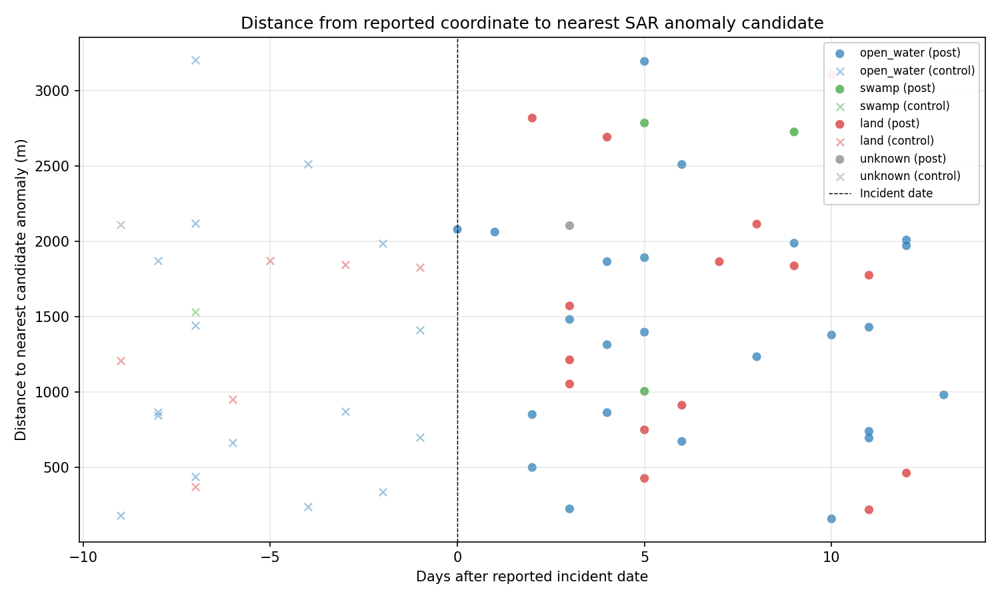
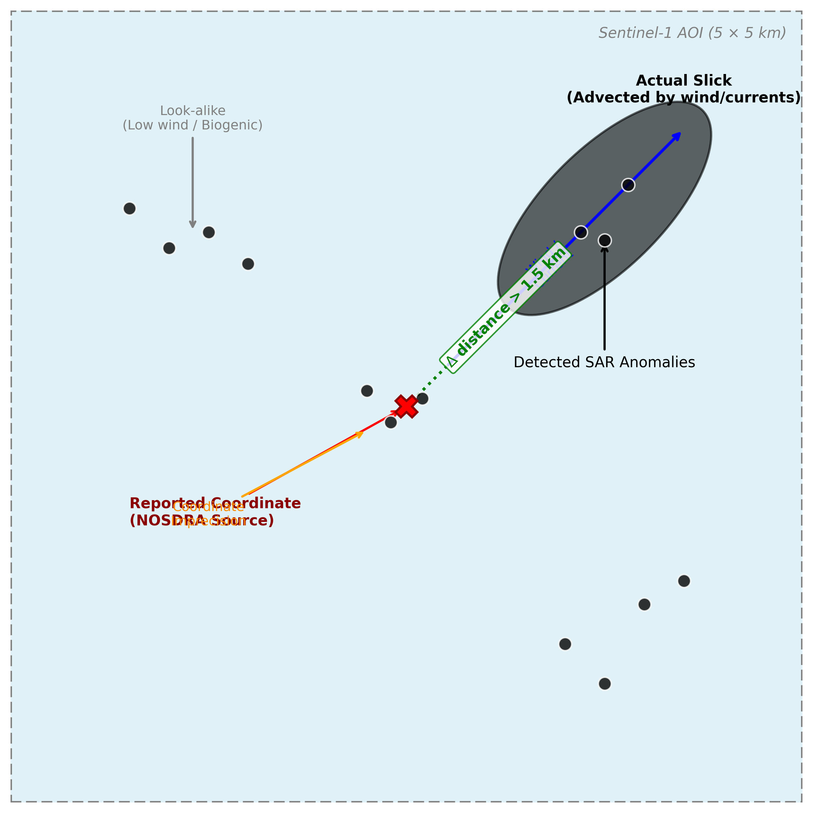

# Assessing the suitability of NOSDRA oil-spill incident records as ground truth for Sentinel-1 SAR-based detection in the Niger Delta

## Abstract

Oil spill detection with Sentinel-1 synthetic aperture radar (SAR) is now routine in the Niger Delta. Many recent studies validate these detections against incident records from the National Oil Spill Detection and Response Agency (NOSDRA). That practice assumes a coordinate recorded at event level also marks the spill's pixel location. We test the assumption. We selected 67 NOSDRA incidents (2015 to 2026), extracted 262 Sentinel-1 acquisitions, and built 178 matched difference images (114 after the incident, 64 before) across 57 incidents. Each image was classified for environmental observability and analyzed with models that account for repeated images of the same incident. Post-incident images contained more dark anomaly clusters than controls in every specification (incidence rate ratios 1.31 to 1.62), but only the Poisson mixed model reaches conventional significance (IRR 1.62, 95% CI 1.28 to 2.06, p < 0.001); the GEE with sandwich standard errors gives 1.54 (0.99 to 2.39, p = 0.057) and a negative-binomial model with incident fixed effects gives 1.44 (0.85 to 2.44, p = 0.17), reflecting the cluster counts' strong overdispersion (variance-to-mean 9.4). The clusters did not sit where the records said. Post-incident clusters were a median of 1,972 m from the reported coordinate (controls 1,848 m), and the two distance distributions did not differ detectably (median difference +125 m, 95% CI −96 to +476 m; Mann-Whitney U = 12,425, p = 0.495). The median distance from the coordinate to the nearest cluster, 1,438 m, fell at the 43rd percentile of the random-point null (median 1,674 m), within the range expected for a random point, and we do not interpret it as carrying a usable spatial signal. Only 4.7 percent of post-incident clusters fell within 500 m of the coordinate. A synthetic injection test recovered 20 of 20 anomalies at 8 dB contrast but only 3 of 20 at the 5 dB detection threshold, so the detector's near-threshold sensitivity is low and the offset is far larger than detector georeferencing error. A sensitivity grid of 15 detector settings left every distance comparison at p > 0.05. NOSDRA records carry a weak event-level temporal signal and no pixel-level spatial signal. We recommend treating them as weak labels and give a four-step workflow for doing so.

## 1. Introduction

Every year, many oil spills in the Niger Delta go unreported or unmonitored (National Oil Spill Detection and Response Agency [NOSDRA], n.d.; Adebangbe et al., 2025b). Persistent cloud cover is one reason: it blinds the optical satellites that would otherwise track the spills (O'Farrell et al., 2025). Synthetic Aperture Radar (SAR) changed this picture. Its microwave frequencies pass through cloud and image the delta surface day or night (Torres et al., 2012; Brekke & Solberg, 2005). Sentinel-1's C-band radar detects oil on water through the damping of capillary waves. A slick smooths the surface, less energy returns to the sensor, and the spill appears as a dark patch against a brighter sea (Alpers et al., 2017). Recent studies use this capability to map chronic contamination, trace slicks to platforms, and argue that SAR reveals a gap between what the regulator records and what the surface shows (Obida et al., 2018; Adebangbe et al., 2025b). The usual reading of that gap is that NOSDRA underreports and that SAR fills the regulatory hole.

That reading rests on an untested assumption. The two data sources must be spatially commensurable for the comparison to mean anything: a spill reported at a coordinate should produce a SAR dark anomaly at that same coordinate, on the same pixel. If the assumption fails, then every detection rate, underreporting ratio, and validation score built on it measures a mismatch in what the two datasets describe, not a property of the environment. NOSDRA records are widely used as validation targets in the SAR oil spill literature (Obida et al., 2021; O'Farrell et al., 2025; Oseni et al., 2026), yet their pixel-level spatial accuracy has not been tested against matched environmental controls. If the comparison between SAR anomalies and regulatory coordinates is invalid, then the studies that use it overstate their case; our contribution is to show that the comparison is invalid and to measure how it fails.

We test it directly. We extracted Sentinel-1 imagery for 67 NOSDRA-confirmed incidents across the Niger Delta between 2015 and 2026, which yielded 262 acquisitions, 241 after acquisition-level quality control, and 178 matched difference images across 57 incidents. Each image was compared with a pre-incident baseline for the same incident, and each acquisition was classified by whether surface oil could be seen at all. Counts of dark anomaly clusters were modeled with mixed-effects, sandwich-variance, and negative-binomial regressions, and the distance from each cluster to the reported coordinate was compared against controls and against a spatial null model. The test has two outcomes, and neither is strong. Post-incident imagery tends to contain more dark clusters than controls, but the effect is directionally consistent and not statistically significant, and it is largest in terrestrial habitat where a marine slick cannot form. The clusters also sit about 1.4 to 2 km from the reported coordinate, within the range expected for a random point, and their distance distribution does not differ before and after the incident. The record says that something was reported, not where the pixels are.

The paper makes three contributions. First, it separates the temporal from the spatial claim about NOSDRA records and shows that both are weak, for different reasons: the temporal signal is fragile under the data's overdispersion and unattributable to oil, and the spatial signal is absent. Second, it attributes the spatial failure to four physical and operational drivers and shows a worked example in which a permanent channel, not a spill, dominates the difference image. Third, it turns the result into a concrete workflow: cluster anomalies independently, use NOSDRA dates as a temporal filter, restrict to observable open-water scenes, and report localization error separately from detection. The recommendation for the field is to treat regulatory records as weak event-level labels rather than pixel-level masks.

## 2. Related Work

Oil pollution in the Niger Delta is a long-running environmental problem because intensive petroleum production overlaps with wetlands, mangroves, and coastal ecosystems (United Nations Environment Programme [UNEP], 2011). Field investigations record individual incidents well but cover few of them, since access is difficult and costly. Satellite remote sensing fills that gap by observing the same ground repeatedly. Optical sensors do part of the job, but cloud cover limits them in the delta. SAR is the practical alternative because it images through cloud and does not need daylight.

NOSDRA maintains the Nigerian Oil Spill Monitor, a database built from Joint Investigation Visits (JIVs). The database is the most complete public record of reported incidents, and remote sensing studies use it to locate pollution hotspots and estimate human and environmental exposure (Obida et al., 2018; Adebangbe et al., 2025b). Independent reviews report problems with completeness and geolocation precision (Denedo et al., 2018). NOSDRA itself notes that submissions are often incomplete, and recent geocomputational work had to drop thousands of records for missing coordinates (NOSDRA, n.d.; Adebangbe et al., 2025b). These issues concern the record as an administrative document. They do not settle whether its coordinates can serve as spatial ground truth for a satellite pixel.

SAR detects marine slicks through a physical mechanism that also produces look-alikes. A slick damps short capillary waves and lowers radar backscatter, which creates a dark feature on the water (Brekke & Solberg, 2005). Biogenic films, low-wind patches, and rain cells can produce the same dark signature (Alpers et al., 2017; Al-Ruzouq et al., 2020). Slick visibility also depends on wind speed and incidence angle (Skrunes et al., 2018; Fingas & Brown, 2018). Below about 3 m/s the surrounding water is already dark, and the slick disappears into the background. These limits mean that a dark anomaly is evidence of a smooth surface, not proof of oil.

Oil also moves. After a release, the slick advects and spreads under wind and surface currents (Jones et al., 2016). The source coordinate is therefore not the location of the surface oil when the satellite passes, especially if the pass comes days later. Comparing a static record to a dynamic observation assumes a spatial and temporal equivalence that may not hold. The time gap between the incident and the image is part of the measurement, not a detail to ignore.

Validation theory gives the same warning. Reference data must match the satellite observation in space, time, and theme (Congalton & Green, 2019; Stehman & Czaplewski, 1998). Geographic data quality standards make fitness for purpose depend on the analytical task, not on the credibility of the institution that produced the data (International Organization for Standardization, 2023). A NOSDRA coordinate is an event-level label: it records that a spill was reported at a facility or village. A SAR anomaly is a pixel-level observation of backscatter. The two are not the same kind of object.

This distinction is the basis of weak supervision, in which coarse or inexact labels guide a model without defining exact boundaries (Zhou, 2018; Yue et al., 2022). NOSDRA records are useful for telling a model where and when to look. Treating the points as pixel-level truth injects label noise, because the oil may have moved and because terrestrial habitat cannot produce a marine slick signature at all. Recent studies map oil pollution and spill risk in the delta with Sentinel-1 and related data. Oseni et al. (2026) map persistent spill risk in Marine Pollution Bulletin by combining Sentinel-1 with environmental exposure indicators and report that exposure extends beyond reported incident locations; their framework inherits the same assumption about coordinate accuracy that we test here. Obida et al. (2021) and O'Farrell et al. (2025) use Sentinel-1 to quantify environmental damage. None of these studies has measured the spatial offset between the regulatory coordinate and the detected anomalies under matched controls. That gap is what this paper fills. We note that weak supervision has not, to our knowledge, been applied to Niger Delta SAR, so our recommendation is a proposed framework rather than a demonstrated improvement.

Counts of anomalies per image are clustered data, because several images belong to one incident. Ignoring the clustering overstates precision (Bolker et al., 2009). Two standard estimators handle it: mixed-effects models, which give each incident its own baseline, and generalized estimating equations, which treat the within-incident correlation as a nuisance (Liang & Zeger, 1986). We use both, together with a negative-binomial cross-check that relaxes the Poisson mean-equals-variance assumption.

## 3. Methods

### 3.1 Data Sources and Incident Selection

Regulatory records came from the Nigerian Oil Spill Monitor (NOSDRA). The raw database held 21,167 records. We kept incidents from 2015 to 2026 with a reported volume of at least 50 barrels, valid coordinates, and a location in a state defined by the Niger Delta Development Commission. This left 67 candidate incidents in seven states (Rivers 13, Bayelsa 13, Delta 11, Abia 11, Imo 10, Edo 6, Akwa Ibom 3); Ondo and Cross River, which the Commission also lists, contributed no qualifying records. The 50-barrel filter uses NOSDRA's own reported volume, so it selects toward higher-volume, higher-profile incidents, the ones most likely to have received careful joint-investigation attention; the failure we document therefore likely understates the coordinate error in the full database. Habitat was taken from the raw records and used to label each site as open water (29), swamp (7), terrestrial (29), or unknown (2). Figure 1 maps the 67 locations.

**Figure 1.** Study area map. The 67 candidate NOSDRA incidents are color-coded by habitat: open water (29), swamp (7), terrestrial (29), and unknown (2). Administrative state names and a 111 km scale bar are shown.

The selection funnel is shown in Figure 2. Of the 67 candidates, 63 returned usable SAR data. Four incidents from early 2015 returned nothing because Sentinel-1 coverage was sparse during the commissioning phase.

**Figure 2.** Sample-selection funnel. Raw NOSDRA records (21,167) were filtered to 67 candidate incidents, 63 of which returned SAR data. The acquisitions (262) were reduced by acquisition-level quality control to 241, and by baseline matching and difference-image quality control to 178 difference images across 57 incidents (114 post-incident, 64 control).

### 3.2 Sentinel-1 Acquisition

Sentinel-1 Interferometric Wide swath Ground Range Detected (GRD) imagery was accessed through the Copernicus Data Space Ecosystem with the openEO backend. For each incident we queried an Area of Interest (AOI) that is a 5 km × 5 km square centered on the reported coordinate (2.5 km half-width; 3.5 km at the corners), for all acquisitions within 14 days of the incident date. The change detection used the VV polarization band (VH co-polarization was available in every acquisition but not used). The scene-center incidence angle was 39.0° for all acquisitions; the IW swath spans roughly 29° to 46° across the image. Pre-processing included thermal noise removal, radiometric calibration to sigma0-ellipsoid, and terrain correction. The query returned 262 acquisitions. Of the 63 incidents with SAR data, one had a single acquisition and no baseline, and five had every acquisition fail the acquisition-level quality filter. That left 57 incidents for analysis.

### 3.3 Environmental Context and Observability

Wind and rain control whether a slick can be seen, so we classified every acquisition before analysis. We retrieved 10 m wind speed and precipitation from ERA5. For each incident we used the nearest ERA5 grid cell with a land fraction below 0.5 within 3 degrees of the coordinate, which avoids the wind-damping effect of land on coastal grid cells. Each acquisition was assigned to one of seven observability classes based on habitat, wind speed, and precipitation. Wind between 3 and 12 m/s was treated as optimal. The classes were observable open water, observable swamp, unobservable terrestrial, unobservable low wind, unobservable no SAR, unknown habitat, and unobservable rain.

The aggregate rate ratio mixes these classes, because each class contributes a different share of acquisitions. We therefore report a stratified analysis that contrasts the observable strata (open water plus swamp) against terrestrial and against the remaining non-optimal scenes. The stratification is descriptive as well as analytical: it shows which habitats drive the aggregate number. One asymmetry is worth stating: a terrestrial acquisition is always classed unobservable regardless of wind, whereas an open-water acquisition is split into observable or low-wind by the wind threshold. Terrestrial habitat therefore appears overrepresented in Table 1 (100 of 241 classified acquisitions) even though acquisitions per incident are comparable across habitats: 103 acquisitions over 29 terrestrial incidents (3.6 per incident), 108 over 29 open-water incidents (3.7), and 25 over 7 swamp incidents (3.6).

### 3.4 Change Detection and Quality Control

For each incident, the baseline was the latest acquisition strictly before the incident date, which in this sample fell 8 to 14 days before the incident (median 13 days). We used the nearest pre-incident acquisition as the baseline because Sentinel-1's 12-day repeat cycle and the 14-day search window make a wider gap (for example, 20 to 30 days) available only by skipping a closer acquisition, which trades a cleaner seasonal control for a weaker temporal one; we accept the 8 to 14 day baseline and treat its residual environmental drift as a limitation. Every later acquisition within the 14-day window was differenced against that baseline. To avoid radar edge artifacts, we required more than 95 percent valid pixels in both images of a pair. Acquisition-level quality control removed 21 of the 262 acquisitions, leaving 241 for classification in Table 1. Baseline matching and difference-image quality control then left 178 difference images across 57 incidents: 114 post-incident targets and 64 pre-incident controls.

The 14-day window is a design choice that biases the spatial comparison toward finding nothing near the coordinate, because most post-incident images are of dispersed or weathered oil. We report it as the primary window for consistency with prior work, and we also report a restriction to the first three days after the incident as a sensitivity analysis (Section 4.5). One property of the design follows from the fixed AOI. A slick that travels farther than 2.5 km from the coordinate cannot be observed, so distance measurements are right-censored at the AOI boundary: we know a distance exceeds 2.5 km (3.5 km at the corners) but not by how much. Censoring affects the upper tail and leaves the median insensitive to it.

### 3.5 Anomaly Candidate Detection

Dark anomaly candidates were found with a dual-threshold rule. A pixel was flagged if it was at least 5.0 dB darker than the image median. Flagged pixels were grouped with 8-connectivity, and groups smaller than 100 pixels were discarded. The threshold pair (5.0 dB, 100 pixels) is the primary setting. To measure how much the results depend on that choice, we repeated the whole pipeline across five contrast thresholds (3, 4, 5, 6, and 7 dB) and three minimum cluster sizes (50, 100, and 200 pixels). The grid has 15 settings and is reported in Section 4.4. We also report two distance metrics: the per-cluster distance from each detected cluster to the reported coordinate, and the per-incident distance from the coordinate to the nearest detected cluster. The former describes how far the detected population sits from the record; the latter is the quantity a localization test should compare against a spatial null.

### 3.6 Detector Validation (Positive Control)

We tested pipeline sensitivity with a synthetic injection. Twenty clean baseline and target pairs were selected. A synthetic Gaussian dark anomaly was injected into each target image, and the same detector was applied. Recovery counted as a detected cluster centroid within 500 m of the injection center. We ran the injection at six peak contrasts (5.0, 5.5, 6.0, 6.5, 7.0, and 8.0 dB) to characterize sensitivity near the 5 dB threshold rather than only above it. The test measures detector sensitivity and georeferencing accuracy. It does not test whether real slicks have the shape, texture, or edge structure that the detector expects, so a high recovery score shows only that the detector finds a dark blob where one was placed, not that it can identify oil.

### 3.7 Statistical Analysis

The outcome is the number of anomaly clusters in an acquisition, a count. The primary contrast is post-incident against control, reported as an incidence rate ratio (IRR). An IRR is the expected number of clusters per post-incident image divided by the expected number per control image. An IRR of 1.62 means about 62 percent more clusters per image after the incident than before it.

The naive rate ratio divides the observed cluster rate per acquisition in one group by the rate in the other. It ignores a structural feature of the data. Several acquisitions belong to the same incident, and images of one incident resemble each other more than images of different incidents. Treating them as independent samples is pseudoreplication: repeated measurements from one unit are counted as if they were separate units, which makes the data look more informative than they are.

A generalized linear mixed model (GLMM) handles this. It fits a Poisson regression for the count and gives each incident its own random intercept, that is, its own baseline cluster rate. The model then compares post-incident and control images within an incident rather than against one overall average. We used a random intercept per incident with a log link and report the IRR, its 95 percent confidence interval, and a model-based p value. We report the GLMM as one estimator, not the only one, because the cluster counts are strongly overdispersed (variance-to-mean ratio 9.4 at the acquisition level). The GLMM's random intercept absorbs between-incident heterogeneity, but not within-incident overdispersion, so its standard errors can be too narrow.

We therefore report three additional estimators. A Poisson GEE with exchangeable working correlation and incident as the clustering unit uses a sandwich estimator that is robust to both clustering and overdispersion (Liang & Zeger, 1986). A negative-binomial GEE adds an explicit overdispersion parameter. A negative-binomial regression with incident fixed effects is the most conservative of the four. The point estimates are expected to agree on direction; whether they agree on significance is itself a finding, because it tells us how fragile the temporal claim is. Model fitting followed the practical guidance in Bolker et al. (2009).

Distance from the reported coordinate to the nearest anomaly candidate was compared between post-incident and control clusters with a Mann-Whitney U test, a rank-based test for whether two groups come from the same distribution. Because a non-significant Mann-Whitney test is not evidence of equivalence, we also report the bootstrap 95 percent confidence interval of the median difference and a two one-sided test (TOST) of equivalence at 300 m and 500 m bounds on the median difference, using a 90 percent confidence interval. The share of clusters within 500 m of the coordinate was compared with a Fisher exact test. Tests were two-sided with alpha set at 0.05.

We placed the spatial result against two null models. First, a random-point null: for each incident we drew 500 points uniformly in the 5 km × 5 km AOI and measured the distance from each to the nearest detected cluster, then compared that distribution to the observed coordinate-to-nearest-cluster distances. Second, a complete-spatial-randomness (CSR) expectation: for an incident with k detected clusters in the 25 km² AOI, the median distance from a random point to the nearest cluster is sqrt(ln 2 / (π k / 25)) km. If the reported coordinate is no closer to a cluster than a random point, the coordinate carries no spatial information beyond what any point in the AOI would.

## 4. Results

### 4.1 Sample Characteristics and Observability

The 262 acquisitions were reduced by quality control to 241 (Table 1). Of these, 178 formed matched difference images (114 post-incident, 64 control) across 57 incidents. Only 89 of the 241 acquisitions (36.9 percent) were acquired under conditions suitable for surface oil detection. Open water was the largest observable class (72), followed by swamp (17). Terrestrial habitat was the largest unobservable class (100), ahead of low wind (40), no SAR (6), unknown habitat (5), and rain (1). The five unknown-habitat acquisitions all belong to a single incident (282326) whose raw record lacks a habitat field; the other unknown-habitat incident (32687) is one of the four early-2015 records that returned no SAR data. The observable difference images in Table 2 number 71.

**Table 1.** Observability classification of the 241 quality-controlled acquisitions.

| Observability class | Count |
|---|---:|
| OBSERVABLE_OPEN_WATER | 72 |
| OBSERVABLE_SWAMP | 17 |
| UNOBSERVABLE_TERRESTRIAL | 100 |
| UNOBSERVABLE_LOW_WIND | 40 |
| UNOBSERVABLE_NO_SAR | 6 |
| UNKNOWN_HABITAT | 5 |
| UNOBSERVABLE_RAIN | 1 |
| **Total** | **241** |

Note: the 6 UNOBSERVABLE_NO_SAR rows are incidents with data extracted but no usable acquisition after quality control (1 single-acquisition incident, 5 with all acquisitions failing QC). Four further incidents yielded no Sentinel-1 data at all and are excluded from Table 1; the 67 candidates therefore consist of 57 analyzed + 6 no-usable-SAR + 4 no-data.

The timing of the acquisitions is part of the result. The first usable post-incident image arrived a median of 3 days after the incident (IQR 1 to 5, range 0 to 11, n = 57 incidents). Across all 114 post-incident images the median gap was 6 days (IQR 3 to 10, range 0 to 13). Control baselines sat a median of 13 days before the incident (IQR 12 to 14, n = 64). The median wind speed at acquisition was 3.97 m/s, with a 5th to 95th percentile range of 1.58 to 5.83 m/s. That distribution straddles the 3 m/s lower limit for slick detection, which is one reason so many scenes fell into the low-wind class.

### 4.2 Detector Validation

The synthetic injection test recovered 20 of 20 injections at 8 dB peak contrast (100 percent) with a median localization error of 11.9 m (IQR 7.3 to 17.9 m). Sensitivity falls steeply as the injected contrast approaches the 5 dB threshold: recovery was 19 of 20 at 7 dB, 17 of 20 at 6.5 dB, 13 of 20 at 6 dB, 6 of 20 at 5.5 dB, and 3 of 20 at 5 dB. The pipeline is therefore reliable for strong, compact dark blobs and unreliable for weak or fragmented slicks near threshold. The result sets a scale for later interpretation: an offset much larger than 11.9 m cannot be explained by gross detector georeferencing error, but a weak real slick could go undetected entirely.

### 4.3 Anomaly Detection and Spatial Mismatch

The validated detector found 336 anomaly candidates in the 178 difference images. Post-incident images held 235 clusters (2.06 per acquisition) and controls held 101 (1.58 per acquisition), for a naive rate ratio of 1.31. The estimators span a range. The Poisson GLMM gave an IRR of 1.62 (95% CI 1.28 to 2.06, p < 0.001). The Poisson GEE gave 1.54 (0.99 to 2.39, p = 0.057). The negative-binomial GEE gave 1.52 (0.98 to 2.36, p = 0.063), and the negative-binomial model with incident fixed effects gave 1.44 (0.85 to 2.44, p = 0.17). The point estimates all exceed 1, so the direction is consistent, but significance depends entirely on how the strong overdispersion (variance-to-mean 9.4) is handled. Under the sandwich-variance estimators the temporal effect is marginal, not decisive. We therefore treat the cluster-rate difference as weakly supported, and we do not attribute it to oil, because the largest effect appears where a marine slick cannot form (Section 4.5).

The central result is spatial, and it points the other way. Post-incident clusters had a per-cluster median distance of 1,972 m from the reported coordinate (IQR 1,314 to 2,467, n = 235). Control clusters had a median of 1,848 m (IQR 1,214 to 2,496, n = 101). The Mann-Whitney test found no detectable difference between the two distributions (U = 12,425, p = 0.495). The median difference was +125 m (bootstrap 95% CI −96 to +476 m), and the median difference was equivalent within 500 m but not within 300 m on a two one-sided test (90% CI −61 to +414 m). Only 11 of 235 post-incident clusters (4.7 percent) fell within 500 m of the coordinate, against 7 of 101 controls (6.9 percent). A Fisher exact test found no detectable difference (odds ratio 0.66, p = 0.43). The median per-cluster offset of 1,972 m is more than 150 times the detector's median localization error of 11.9 m.

The nearest-cluster metric is no more informative. The median distance from the coordinate to the nearest detected cluster was 1,438 m across the 32 incidents with at least one post-incident cluster. Under the random-point null, a uniformly random point in the same AOI was 1,674 m from the nearest cluster on average (5th to 95th percentile 270 to 4,411 m), and the CSR expectation for the observed cluster densities was about 1,356 m. The observed 1,438 m falls at the 43rd percentile of the null distribution, within the range expected for a random point, and we do not interpret it as carrying a usable spatial signal. The aggregate test had 99.8 percent power to detect a 500 m shift toward the coordinate, so the absence of such a shift is informative at the full-sample level; the terrestrial stratum, with only 11 control clusters, had 21 percent power, and its null is uninformative.

Figure 3 shows what the mismatch looks like on the ground. Incident 142357 was reported in Bayelsa on 2018-10-17 at an estimated volume of 1,751 barrels, near the upper end of the sample (median 105 barrels) in the modal open-water habitat. The baseline image is from 2018-10-03; the post-incident mean combines scenes from 10-22 and 10-27. The dark diagonal feature crossing the scene is a permanent water channel that appears in both periods. No transient anomaly appears at the reported coordinate. The difference image shows darkening concentrated along the static channel edge, which is a co-registration artifact: a small misregistration between the two dates makes a fixed edge look like a change. The coordinate vicinity shows only background noise.

**Figure 3.** Visual mismatch for Incident 142357 (Bayelsa, reported 2018-10-17, 1,751 barrels). (a) Baseline acquisition, 2018-10-03. (b) Post-incident mean of 2018-10-22 and 2018-10-27. (c) Difference image (post minus baseline; red indicates darkening). The yellow circle marks the reported NOSDRA coordinate. The dark diagonal feature is a permanent water channel present in both periods. No transient anomaly appears at the coordinate. Darkening concentrates along the static channel edge, a co-registration artifact.

Figure 4 shows distance to the nearest candidate against days after the incident, colored by habitat. Points do not converge on the origin at short gaps. The cloud stays broad at zero to three days, which is what a coordinate-level mismatch looks like when the oil has not had time to travel far.

**Figure 4.** Distance from the reported NOSDRA coordinate to the nearest detected anomaly candidate, plotted against days after the incident and colored by habitat. Short gaps do not produce short distances, which argues against advection alone as the source of the offset.

The stratified results appear in Table 2. The cluster-rate signal is moderate in observable habitats (GLMM IRR 1.68, 95% CI 1.19 to 2.39, p = 0.004) and in open water alone (1.59, 95% CI 1.11 to 2.27, p = 0.011). It is highest in terrestrial habitat (2.45, 95% CI 1.30 to 4.64, p = 0.006) and near one in the remaining non-optimal scenes (0.87, 95% CI 0.55 to 1.39, p = 0.559). The distance comparison tells a different story. Every stratum has a median offset between 1,682 and 2,090 m, and no stratum shows a detectable difference between post-incident and control distances (all p ≥ 0.161). The GEE cross-check moves two of the five cluster-rate estimates toward the null and three away from it; none of the GEE intervals excludes 1, and the terrestrial and swamp strata have too few control clusters (11 and 0) for their ratios to be read inferentially.

**Table 2.** Stratified anomaly detection results. Post and Ctrl Acq are the numbers of post-incident and control acquisitions. Clusters are counts. The naive ratio is the observed post/control clusters per acquisition. The GLMM IRR is one estimator; the GEE is a sandwich-variance cross-check. Distance is the median distance in meters from the reported coordinate to the nearest candidate; the Mann-Whitney p compares post and control distance distributions.

| Stratum | Post Acq | Ctrl Acq | Post clusters | Ctrl clusters | Naive ratio | GLMM IRR (95% CI) | GLMM p | GEE IRR (95% CI) | GEE p | Median distance (post/ctrl, m) | Mann-Whitney p |
|---|---:|---:|---:|---:|---:|---|---:|---|---:|---|---:|
| All QC-passing | 114 | 64 | 235 | 101 | 1.31 | 1.62 (1.28 to 2.06) | <0.001 | 1.54 (0.99 to 2.39) | 0.057 | 1,972 / 1,848 | 0.495 |
| Observable (OW + swamp) | 44 | 27 | 129 | 52 | 1.52 | 1.68 (1.19 to 2.39) | 0.004 | 1.71 (0.92 to 3.17) | 0.091 | 2,007 / 1,682 | 0.161 |
| Open water only | 36 | 21 | 123 | 52 | 1.38 | 1.59 (1.11 to 2.27) | 0.011 | 1.54 (0.83 to 2.87) | 0.170 | 1,972 / 1,682 | 0.258 |
| Terrestrial | 48 | 26 | 52 | 11 | 2.56 | 2.45 (1.30 to 4.64) | 0.006 | 2.49 (0.86 to 7.18) | 0.092 | 1,762 / 1,848 | 0.568 |
| Other (low wind, rain, unknown) | 22 | 11 | 54 | 38 | 0.71 | 0.87 (0.55 to 1.39) | 0.559 | 0.82 (0.47 to 1.44) | 0.495 | 2,090 / 1,986 | 0.631 |

Note: the swamp-only stratum is not shown separately (8 post-incident and 6 control acquisitions, 6 post clusters and 0 control clusters). Its rate ratio is undefined because the control rate is zero. The terrestrial stratum's distance null is uninformative at 11 control clusters (21 percent power to detect a 500 m shift).

### 4.4 Sensitivity Analysis

The detector has two free parameters, and Section 3.5 fixed both. Table 3 reports the full 15-setting grid. Cluster counts change by more than two orders of magnitude across it: at 3 dB and 50 pixels the detector returned 5,405 post-incident and 3,690 control clusters, while at 7 dB and 200 pixels it returned 30 and 17. The naive rate ratio ranged from 0.822 to 1.587 and fell below 1 at six of the 15 settings, four of them at 3 or 4 dB, where background texture in both periods swamps the incident signal. The magnitude, and in places the direction, of the cluster-rate result therefore depends on the parameters. The spatial result does not. Across all 15 settings the median post-incident distance stayed between 1,532 and 1,985 m and the median control distance between 1,480 and 1,994 m. No Mann-Whitney comparison reached p < 0.05; p ranged from 0.082 to 0.956, so no setting clears even the conventional threshold, let alone a Bonferroni-corrected threshold of 0.0033. At the primary setting (5 dB, 100 pixels) the grid reproduces the main counts of 235 and 101 clusters and a median post distance of 1,985 m, close to the 1,972 m reported in Section 4.3. The spatial mismatch is stable across every parameter choice; the cluster-rate effect is not.

**Table 3.** Sensitivity grid. Detection was rerun at five contrast thresholds and three minimum cluster sizes. Distance columns are medians in meters from the reported coordinate to the nearest candidate.

| Contrast (dB) | Min cluster (px) | Post clusters | Ctrl clusters | Rate ratio | Median post distance (m) | Median ctrl distance (m) | Mann-Whitney p |
|---:|---:|---:|---:|---:|---:|---:|---:|
| 3 | 50 | 5,405 | 3,690 | 0.822 | 1,952 | 1,994 | 0.082 |
| 3 | 100 | 1,384 | 864 | 0.899 | 1,938 | 1,959 | 0.868 |
| 3 | 200 | 384 | 224 | 0.962 | 1,885 | 1,992 | 0.349 |
| 4 | 50 | 1,719 | 1,063 | 0.908 | 1,937 | 1,920 | 0.956 |
| 4 | 100 | 503 | 257 | 1.099 | 1,947 | 1,917 | 0.812 |
| 4 | 200 | 155 | 66 | 1.318 | 1,856 | 1,910 | 0.445 |
| 5 | 50 | 745 | 423 | 0.989 | 1,944 | 1,908 | 0.493 |
| 5 | 100 | 235 | 101 | 1.306 | 1,985 | 1,852 | 0.502 |
| 5 | 200 | 82 | 29 | 1.587 | 1,935 | 1,665 | 0.349 |
| 6 | 50 | 390 | 209 | 1.048 | 1,909 | 1,840 | 0.404 |
| 6 | 100 | 129 | 55 | 1.317 | 1,849 | 1,757 | 0.461 |
| 6 | 200 | 55 | 23 | 1.342 | 1,608 | 1,491 | 0.693 |
| 7 | 50 | 236 | 118 | 1.123 | 1,771 | 1,825 | 0.867 |
| 7 | 100 | 85 | 39 | 1.224 | 1,532 | 1,657 | 0.691 |
| 7 | 200 | 30 | 17 | 0.991 | 1,701 | 1,480 | 0.245 |

### 4.5 Temporal Signal Localization and Robustness

The timing data resolve the temporal signal further. Restricting post-incident images to the first three days after the incident (11 images, 84 clusters) raises the Poisson GLMM point estimate to IRR 2.05 (95% CI 1.41 to 2.96); the GEE is not reported for this subset because 11 images makes the sandwich variance unstable. The nearest-cluster distances do not differ detectably from controls (median 1,861 m, Mann-Whitney p = 0.97). The cluster-rate signal is therefore, if anything, concentrated in the earliest window, yet even there it carries no spatial localization. Requiring at least two post-incident acquisitions per incident (45 incidents) leaves the GLMM at IRR 1.52 (1.19 to 1.93) and the distance comparison unchanged (p = 0.43), so the temporal signal is not an artifact of single-acquisition incidents.

The strongest reason not to read the temporal signal as oil is its location. The terrestrial stratum has the largest cluster-rate ratio (2.45) of any stratum, yet a terrestrial acquisition cannot contain a marine slick, because the habitat cannot support standing open water. The temporal signal therefore includes, and is likely dominated by, environmental change that correlates with incident dates but is not oil: soil-moisture and vegetation change between the baseline (median 13 days before) and the post-incident images, and seasonal rewetting of low ground. A dark cluster on land in our data is more likely to be environmental change than oil.

### 4.6 Visual Inspection

A single analyst inspected the 63 incidents with usable SAR imagery, blind to the quantitative results. None was judged a coherent spill signature. The original verdicts were 27 no-signal, 22 land-only, and 18 unclear; the "unclear" category covers frames where the annotator could not distinguish a slick from a look-alike (channels, wet ground, co-registration edges). The four early-2015 incidents with no SAR imagery were not inspected. We treat the result as suggestive rather than confirmatory because it derives from a single annotator and inter-rater reliability was not assessed; it is consistent with the automated distance result and is not the paper's primary evidence.

## 5. Discussion

The results split into two parts, and both are weaker than the literature assumes. The temporal part: post-incident images do contain more dark clusters per acquisition, but the size of the effect is estimator-dependent (IRR 1.31 to 1.62) and its significance is not robust to the data's overdispersion. The Poisson GLMM gives p < 0.001; the GEE with sandwich standard errors gives p = 0.057; the negative-binomial model gives p = 0.17. We report all of them rather than selecting one. The spatial part is unambiguous: the clusters sit about 1.4 to 2 km from the reported coordinate, the post and control distance distributions do not differ detectably (p = 0.495), and only 4.7 percent of post-incident clusters fall within 500 m. That p value compares post-incident with control images; it is not a test of zero offset. We tested zero offset separately: the median difference is +125 m (95% CI −96 to +476 m), and the median difference is equivalent only at a 500 m bound. The 1,972 m median per-cluster offset is more than 150 times the detector's 11.9 m localization error, so random localization error cannot explain it. We do not conclude that Sentinel-1 cannot detect oil in the Niger Delta. The synthetic test and the temporal signal both say the opposite. The failure is one of localization. A NOSDRA point marks an event, not the pixel where the event is visible.

The cluster-rate result needs the mixed model, because the naive analysis treats repeated images as independent and understates the uncertainty. Each incident contributes several images, and images of one incident resemble each other. Pseudoreplication treats those repeats as independent evidence and inflates confidence. The naive ratio is 1.31, the Poisson GLMM 1.62, the GEE 1.54, and the negative-binomial model 1.44. All agree on direction. But the estimators disagree on significance, and the disagreement is informative: it is driven by the acquisition-level overdispersion (variance-to-mean 9.4), which the Poisson GLMM does not fully absorb. The GEE's sandwich estimator and the negative-binomial parameter both widen the interval toward or past 1. We therefore do not claim a significant temporal effect; we claim a directionally consistent one that is marginal under the most defensible estimator. This is a different and weaker conclusion than a p < 0.001 headline would suggest, and it is the honest one.

The temporal signal, where it exists, cannot be attributed to oil. The terrestrial stratum has the highest cluster-rate ratio (2.45), yet it cannot contain a marine slick. The pattern is consistent with environmental change correlated with incident dates: soil moisture, seasonal rewetting, and vegetation phenology all shift C-band backscatter between a baseline 13 days before the incident and a post-incident image 3 to 6 days after. The 'Other' stratum, with its ratio near 1, behaves as expected for scenes where detection conditions were poor. The spatial null model reinforces the point: the reported coordinate sits within the range expected for a random point in the same AOI (43rd percentile of the null), so the temporal signal is not a localization signal.

We identify four drivers of the spatial misalignment, summarized in Figure 5. First, oil is dynamic. NOSDRA provides a single coordinate for the source, but between the incident and the overpass the oil advects and spreads with wind and surface currents (Jones et al., 2016). A spill reported at a point will rarely stay at that point by the time Sentinel-1 observes it. Second, the observation domains differ. More than half of the incidents in our sample occurred in terrestrial or swamp habitat. In swamp, a slick can form only where standing water is present; in terrestrial habitat the marine signature cannot form at all. Third, the coordinates are imprecise. Coordinates recorded during JIVs are often logged at a facility or village centroid, or rounded to low precision. That administrative uncertainty alone can produce offsets of hundreds of meters to kilometers. Fourth, environmental masking hides or mimics the signal. Wind below 3 m/s prevents the capillary-wave contrast that makes a slick visible, and rain and low wind also create dark patches that look like oil.

The timing data sharpen the first driver. The first post-incident image arrives a median of 3 days after the incident, and all post-incident images have a median gap of 6 days. At typical surface currents, a slick may travel well beyond the 2.5 km AOI half-width in that time, or disperse below the detection threshold. The wind distribution compounds the problem: the median is 3.97 m/s, the 5th to 95th percentile range (1.58 to 5.83 m/s) reaches below the 3 m/s detection floor, and 40 of the 241 classified acquisitions fell into the low-wind class. Scenes that cannot show a slick are exactly the scenes where a coordinate match would be meaningless. The detector's own near-threshold sensitivity adds a further limit: recovery falls from 20 of 20 at 8 dB to 3 of 20 at 5 dB, so a weak or weathered slick can be missed even in an observable scene.

These findings matter for how the field validates SAR. Studies that compare Sentinel-1 detections against NOSDRA records often assume that a SAR anomaly near a record is an unreported spill, and that a missing anomaly is an underreporting failure. Our data show that assumption conflates event-level reporting with pixel-level observation. Using NOSDRA points as direct masks for training or evaluation injects label noise: a model trained on them learns the spatial imprecision of the database, not the physical signature of oil. The same logic applies to match rates quoted as accuracy. If only 4.7 percent of clusters fall within 500 m of the record, a pixel-overlap metric will report near-zero skill even when the detector is working.

The natural follow-up question is what should replace NOSDRA as pixel-level ground truth. The options are limited: field-verified slick polygons are scarce, industry-confirmed locations are not public, and hand-annotated optical slicks are obstructed by cloud. SkyTruth's Cerulean platform and similar operational products offer independent oil detections, but their own validation against field truth in the delta is thin. Until a field-verified reference exists, the field has a measurement problem that goes beyond NOSDRA, and the correct posture is to report localization uncertainty rather than assume a coordinate is a pixel.

The weak-label recommendation can be operationalized. Four steps turn it into a workflow. (1) Detect and cluster dark anomalies across a region without using NOSDRA points as seeds or masks, keep the detector settings fixed, and report them. (2) Use NOSDRA dates only as a temporal filter: link a record to clusters found within a stated window (14 days here) and a stated radius (2.5 km half-width here), and treat the link as event level. (3) Restrict the primary sample to open-water scenes with wind between 3 and 12 m/s and no rain, or model observability explicitly as in Table 2. (4) Report localization error separately from detection performance, and never feed the point coordinate into a model as a pixel label. Under this design, a NOSDRA record answers "did something happen near here, and when", not "which pixels are oil". That is a weaker claim than the literature often makes, but it is one the data support.

**Figure 5.** Conceptual diagram of the four drivers of spatial misalignment between reported NOSDRA coordinates and detected SAR anomalies: oil advection, domain mismatch between terrestrial records and marine SAR, coordinate imprecision from administrative recording, and environmental masking by low wind and rain.

## 6. Conclusion

This study tested whether NOSDRA oil spill records can serve as pixel-level ground truth for Sentinel-1 SAR detection in the Niger Delta. They cannot. Post-incident acquisitions contain somewhat more dark anomaly clusters than matched pre-incident controls (incidence rate ratios 1.31 to 1.62 across estimators), but the effect is not significant once the data's overdispersion is modeled (GEE IRR 1.54, p = 0.057; negative-binomial p = 0.17), and it is largest in terrestrial habitat where oil cannot produce the signature. The clusters sit a median of 1,972 m from the reported coordinate (controls 1,848 m), and the post and control distance distributions do not differ detectably (p = 0.495; median difference +125 m); the nearest cluster is 1,438 m away on average, within the range expected for a random point (null median 1,674 m). A synthetic injection test rules out gross detector georeferencing error as the cause but shows near-threshold sensitivity is low (3 of 20 at 5 dB), and a 15-setting sensitivity grid leaves the distance result unchanged while the cluster-rate result changes sign and magnitude. Four drivers explain the offset: oil advection, a mismatch between terrestrial records and marine SAR, coordinate imprecision, and environmental masking. The practical recommendation is to stop using NOSDRA points as spatial masks. Instead, detect anomalies independently, use the records as temporal filters on observed open-water scenes, and evaluate at event level. Regulatory records are a record of reporting. They are not a map of oil.

## 7. Limitations

Several limits apply. The spatial analysis used a fixed 5 km × 5 km AOI (2.5 km half-width), so distances are right-censored at that boundary (3.5 km at the corners). Large slicks that advected farther are truncated, which shrinks the upper tail; the median is readable, but the mean is biased low. Wind and precipitation came from ERA5 reanalysis grid cells rather than local stations, so localized wind effects are smoothed. The synthetic injection confirms detector sensitivity and georeferencing, not the realism of real slick morphology; a Gaussian blob is easier to find than a fragmented, weathered slick, and detection probability falls from 20 of 20 at 8 dB to 3 of 20 at 5 dB. The analysis used Sentinel-1 C-band GRD products in VV polarization only. Higher-resolution or quad-polarimetric sensors may discriminate better in complex coastal settings. The cluster counts are strongly overdispersed, so Poisson standard errors are too narrow and the temporal effect's significance is estimator-dependent; we report the sandwich-variance estimates alongside the GLMM. Several strata are small (11 control clusters in the terrestrial stratum, none in the swamp stratum), so stratum-specific ratios carry wide uncertainty and should be read descriptively; the terrestrial distance null has 21 percent power for a 500 m shift. The visual inspection was performed by a single analyst and inter-rater reliability was not assessed. The 14-day post-incident window includes many images of dispersed oil, which biases the spatial comparison toward no signal; the first-three-day restriction is a partial correction but has few images. The baseline (8 to 14 days before the incident) is not a seasonal control and may contain earlier, unrelated spills. The sensitivity grid spans 3 to 7 dB and 50 to 200 pixels, so stability outside that range is untested. Finally, the study compares a detector to a record. It does not have field-verified slick polygons, so it cannot say whether any individual dark cluster is oil. That question needs a different dataset.

## References

Adebangbe, S. A., Dixon, D. P., & Barrett, B. (2025b). Geo-computation techniques for identifying spatio-temporal patterns of reported oil spills along crude oil pipeline networks. *International Journal of Digital Earth, 18*(1), Article 2448218. https://doi.org/10.1080/17538947.2024.2448218

Alpers, W., Holt, B., & Zeng, K. (2017). Oil spill detection by imaging radars: Challenges and pitfalls. *Remote Sensing of Environment, 201*, 133-147. https://doi.org/10.1016/j.rse.2017.09.002

Al-Ruzouq, R., Gibril, M. B. A., Shanableh, A., Kais, A., Hamed, O., Al-Mansoori, S., & Khalil, M. A. (2020). Sensors, features, and machine learning for oil spill detection and monitoring: A review. *Remote Sensing, 12*(20), Article 3338. https://doi.org/10.3390/rs12203338

Bolker, B. M., Brooks, M. E., Clark, C. J., Geange, S. W., Poulsen, J. R., Stevens, M. H. H., & White, J.-S. S. (2009). Generalized linear mixed models: A practical guide for ecology and evolution. *Trends in Ecology & Evolution, 24*(3), 127-135. https://doi.org/10.1016/j.tree.2008.10.008

Brekke, C., & Solberg, A. H. S. (2005). Oil spill detection by satellite remote sensing. *Remote Sensing of Environment, 95*(1), 1-13. https://doi.org/10.1016/j.rse.2004.11.015

Congalton, R. G., & Green, K. (2019). *Assessing the accuracy of remotely sensed data: Principles and practices* (3rd ed.). CRC Press.

Denedo, M., Thomson, I., & Yonekura, A. (2018). Accountability, maps and inter-generational equity: Evaluating the Nigerian Oil Spill Monitor. *Public Money & Management, 38*(5), 355-364. https://doi.org/10.1080/09540962.2018.1477662

Fingas, M., & Brown, C. E. (2018). A review of oil spill remote sensing. *Sensors, 18*(1), Article 91. https://doi.org/10.3390/s18010091

International Organization for Standardization. (2023). *Geographic information - Data quality - Part 1: General requirements* (ISO Standard No. 19157-1:2023). https://www.iso.org/standard/78900.html

Jones, C. E., Dagestad, K.-F., Breivik, Ø., Holt, B., Röhrs, J., Christensen, K. H., Espeseth, M., Brekke, C., & Skrunes, S. (2016). Measurement and modeling of oil slick transport. *Journal of Geophysical Research: Oceans, 121*(10), 7759-7775. https://doi.org/10.1002/2016JC012113

Liang, K.-Y., & Zeger, S. L. (1986). Longitudinal data analysis using generalized linear models. *Biometrika, 73*(1), 13-22. https://doi.org/10.1093/biomet/73.1.13

National Oil Spill Detection and Response Agency. (n.d.). *About the data*. Nigerian Oil Spill Monitor. https://nosdra.oilspillmonitor.ng/data.html

Obida, C. B., Blackburn, G. A., Whyatt, J. D., & Semple, K. T. (2018). Quantifying the exposure of humans and the environment to oil pollution in the Niger Delta using advanced geostatistical techniques. *Environment International, 111*, 32-42. https://doi.org/10.1016/j.envint.2017.11.009

Obida, C. B., Blackburn, G. A., Whyatt, J. D., & Semple, K. T. (2021). Counting the cost of the Niger Delta's largest oil spills: Satellite remote sensing reveals extensive environmental damage with >1 million people in the impact zone. *Science of the Total Environment, 775*, Article 145854. https://doi.org/10.1016/j.scitotenv.2021.145854

O'Farrell, J., O'Fionnagáin, D., Babatunde, A. O., Geever, M., Codyre, P., Murphy, P. C., Spillane, C., & Golden, A. (2025). Quantifying the impact of crude oil spills on the mangrove ecosystem in the Niger Delta using AI and Earth observation. *Remote Sensing, 17*(3), Article 358. https://doi.org/10.3390/rs17030358

Oseni, R. D., Omosanya, K. O. L., Mosuro, G. O., Saka, H. O., Oludipe, V. D., & Oshomoji, A. (2026). Mapping persistent oil spill risk in the Niger Delta using Sentinel-1 SAR and environmental exposure indicators. *Marine Pollution Bulletin, 229*, Article 119674. https://doi.org/10.1016/j.marpolbul.2026.119674

Skrunes, S., Brekke, C., Jones, C. E., Espeseth, M. M., & Holt, B. (2018). Effect of wind direction and incidence angle on polarimetric SAR observations of slicked and unslicked sea surfaces. *Remote Sensing of Environment, 213*, 73-91. https://doi.org/10.1016/j.rse.2018.05.001

Stehman, S. V., & Czaplewski, R. L. (1998). Design and analysis for thematic map accuracy assessment: Fundamental principles. *Remote Sensing of Environment, 64*(3), 331-344. https://doi.org/10.1016/S0034-4257(98)00010-8

Torres, R., Snoeij, P., Geudtner, D., Bibby, D., Davidson, M., Attema, E., Potin, P., Rommen, B., Floury, N., Brown, M., Navas Traver, I., Deghaye, P., Duesmann, B., Rosich, B., Miranda, N., Bruno, C., L'Abbate, M., Croci, R., Pietropaolo, A., ... Rostan, F. (2012). GMES Sentinel-1 mission. *Remote Sensing of Environment, 120*, 9-24. https://doi.org/10.1016/j.rse.2011.05.028

United Nations Environment Programme. (2011). *Environmental assessment of Ogoniland*. https://wedocs.unep.org/handle/20.500.11822/7947

Yue, J., Fang, L., Ghamisi, P., Xie, W., Li, J., Chanussot, J., & Plaza, A. (2022). Optical remote sensing image understanding with weak supervision: Concepts, methods, and perspectives. *IEEE Geoscience and Remote Sensing Magazine, 10*(2), 250-269. https://doi.org/10.1109/MGRS.2022.3161377

Zhou, Z.-H. (2018). A brief introduction to weakly supervised learning. *National Science Review, 5*(1), 44-53. https://doi.org/10.1093/nsr/nwx106
